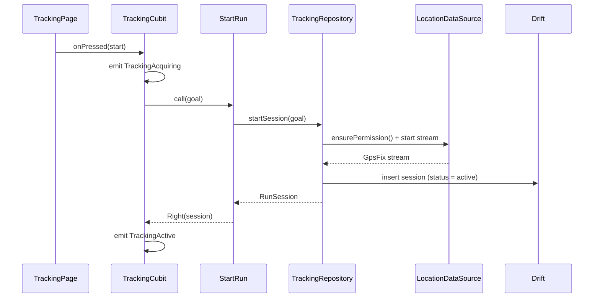

# Architecture

Sleman Runs is a **feature-first clean architecture** app with a single, strictly enforced dependency direction. This document is the map: what goes where, why, and which principle each piece demonstrates.

> Rule of thumb: if you cannot explain why a file exists in one sentence, it belongs somewhere else.

---

## 1. The dependency rule

```
        ┌───────────────────────────────┐
        │        presentation           │  Flutter, Bloc, widgets
        └───────────────┬───────────────┘
                        │ depends on
        ┌───────────────▼───────────────┐
        │           domain              │  pure Dart: entities,
        │  entities · use cases · ports │  use cases, repository interfaces
        └───────────────▲───────────────┘
                        │ implements
        ┌───────────────┴───────────────┐
        │             data              │  drift, geolocator, HTTP
        └───────────────────────────────┘
```

- **domain** imports nothing from `data`, `presentation`, Flutter, or any plugin.
- **data** implements domain interfaces and may import domain.
- **presentation** may import domain, never `data`.
- **core** is shared infrastructure and must not import a feature.
- A feature may never import another feature's `data` or `presentation`. Cross-feature reuse goes through `shared` or a domain interface.

This is checked by `dependency_validator` in CI, not just by good intentions.

## 2. Folder map

```
lib/
├── main.dart                  # entry: bootstrap + runApp
├── bootstrap.dart             # DI, error handlers, l10n, orientation
├── app/
│   ├── app.dart               # MaterialApp.router, themes, locales
│   ├── router/                # go_router config, path constants, guards
│   ├── di/                    # get_it registration modules
│   ├── theme/                 # ColorScheme, ThemeExtensions, typography
│   └── l10n/                  # app_en.arb, app_ar.arb, generated/
├── core/
│   ├── error/                 # Failure hierarchy, error mapper
│   ├── result/                # typedef Result<T> = Either<Failure, T>
│   ├── database/              # Drift database, migrations, converters
│   ├── services/              # Clock, Logger, Connectivity, Permissions
│   ├── utils/                 # formatters (pace, distance, duration)
│   └── validators/
├── features/
│   ├── onboarding/
│   ├── tracking/              # live GPS run
│   │   ├── domain/
│   │   │   ├── entities/      # TrackPoint, RunSession, Split, GpsFix
│   │   │   ├── repositories/# TrackingRepository (abstract)
│   │   │   ├── services/      # GpsFilter, DistanceCalculator, AutoPauseDetector
│   │   │   └── usecases/      # StartRun, PauseRun, FinishRun, ...
│   │   ├── data/
│   │   │   ├── datasources/   # RunLocalDataSource, LocationDataSource
│   │   │   ├── models/        # Drift rows + entity mappers
│   │   │   └── repositories/  # TrackingRepositoryImpl
│   │   └── presentation/
│   │       ├── cubit/
│   │       ├── pages/
│   │       └── widgets/       # map, metrics, controls
│   ├── history/               # list, detail, edit, delete
│   ├── stats/                 # weekly volume, streaks, charts
│   ├── plans/                 # training plan strategies
│   └── settings/              # theme mode, language, units, permissions
└── shared/
    ├── widgets/               # buttons, empty states, error views
    └── extensions/            # BuildContext, DateTime, num
```

Each feature is a vertical slice: `domain` → `data` → `presentation`. Adding a feature means adding a folder, not editing five layers.

## 3. Layers in practice

### Domain

Pure Dart. No Flutter, no Drift, no `geolocator`. This is the only place business rules live, and therefore the only place that *needs* exhaustive tests.

```dart
abstract interface class TrackingRepository {
  Future<Result<RunSession>> startSession(RunGoal goal);
  Future<Result<void>> appendPoints(String sessionId, List<TrackPoint> points);
  Future<Result<RunSession>> finishSession(String sessionId);
  Future<Result<RunSession>> recoverSession();
}
```

Use cases are single-purpose callables:

```dart
final class FinishRun {
  const FinishRun(this._repository);
  final TrackingRepository _repository;

  Future<Result<RunSession>> call(String sessionId) =>
      _repository.finishSession(sessionId);
}
```

### Data

Owns all I/O: Drift queries, `geolocator` streams, permissions. It maps DTOs/rows to domain entities and converts exceptions into `Failure`s at the boundary. Nothing above `data` ever sees a `SQLiteException` or a `PlatformException`.

### Presentation

One Cubit per screen-level concern, immutable sealed states, and widgets that only render. Cubits depend on use cases via constructor injection; they never see `TrackingRepositoryImpl`.

```dart
sealed class TrackingState extends Equatable {
  const TrackingState();
}

final class TrackingIdle extends TrackingState { ... }
final class TrackingAcquiring extends TrackingState { ... }
final class TrackingActive extends TrackingState {
  const TrackingActive({
    required this.elapsed,
    required this.distanceMeters,
    required this.currentPace,
    required this.splits,
    required this.gpsAccuracyMeters,
    required this.autoPaused,
  });
  // ...
}
final class TrackingFinished extends TrackingState { ... }
final class TrackingFailure extends TrackingState { ... }
```

Sealed states make `switch` exhaustive, so a new state breaks compilation instead of silently producing a blank screen.

## 4. SOLID, mapped to real files

| Principle | Where it lives | What it means here |
| --- | --- | --- |
| **S — Single responsibility** | `RunRepository` persists; `DistanceCalculator` measures; `GpsFilter` cleans | A class changes for exactly one reason. No "RunManager" that does five things. |
| **O — Open/closed** | `TrainingPlanStrategy` + `Beginner5k`, `Intermediate10k`, `HalfMarathon` | New plan types are new files, not new `if`s. |
| **L — Liskov** | Every `TrainingPlanStrategy` produces a valid plan for any date range | Substitutions never break the caller's contract. |
| **I — Interface segregation** | `RunReader` and `RunWriter` are separate ports | Stats only depends on reads; tracking only depends on writes. |
| **D — Dependency inversion** | Cubits depend on use cases; use cases on abstract repositories | Swapping Drift for a remote API touches `data` only. |

Also enforced: **composition over inheritance** (strategies and injected services, not deep class trees) and **explicit boundaries** (no `BuildContext` below `presentation`).

## 5. Data flow

### Starting a run



### Every GPS fix

```
GpsFix ──▶ GpsFilter ──▶ TrackPoint ──▶ DistanceCalculator ──▶ RunSession
           accuracy          accepted      incremental          aggregate
           distance gate     fix           delta + split         + notifier
```

`GpsFilter` rejects fixes with accuracy worse than 25 m, jumps implying > 12 m/s, and duplicates within 1 s. Rules are pure and unit-tested against recorded tracks — no phone needed.

### Crash safety

While a run is active, accepted points are flushed to Drift **every 5 seconds** (batched, not per fix) with `session.status = active`. On app start, `RecoverSession` looks for an unfinished session and offers to resume it. Losing a 40-minute run because of a notification-killed process is the failure mode this design exists to prevent.

## 6. Error handling

No exceptions cross a layer boundary. `data` catches, logs, and returns `Failure`:

```dart
sealed class Failure {
  const Failure(this.message, {this.cause});
  final String message;
  final Object? cause;
}

final class PermissionFailure extends Failure { ... }   // location denied/forever
final class LocationServiceFailure extends Failure { ... } // GPS disabled
final class DatabaseFailure extends Failure { ... }
final class ValidationFailure extends Failure { ... }
final class UnknownFailure extends Failure { ... }
```

`Result<T> = Either<Failure, T>`. Cubits `fold` into a `Failure` state that the UI renders with a localized message and a retry action. Failures carry a stable key, not a user-facing string, so ARB owns the wording.

## 7. Offline-first

Local Drift is the **source of truth**, not a cache. There is no backend in v1, so "offline" is not a mode: the app simply never needed a network.

v2 adds sync without rewriting features:

- Every row has `updated_at`, `deleted_at` (tombstone), and `sync_state`.
- A `SyncQueue` table records local writes; a `SyncWorker` drains it when connectivity returns.
- Repositories keep the same interface — only the implementation gains a remote data source.
- Conflict policy: last-write-wins on run edits, append-only for track points.

Designing for this now costs one migration; retrofitting it later costs a rewrite.

## 8. Localization and directionality

- ARB files under `app/l10n`, generated accessors via `flutter gen-l10n`, no hardcoded strings in widgets.
- `Directionality` follows the locale automatically; layout uses logical properties (`EdgeInsetsDirectional`, `start`/`end`).
- Numbers, paces and timestamps stay LTR inside RTL text using `Directionality(textDirection: TextDirection.ltr)` wraps.
- Plural and placeholder rules live in ARB so Arabic gets its six plural forms correctly.
- Unit labels (`km`, `mi`) come from settings, not from the locale — a preference, not a translation.

## 9. Design system

`ThemeExtension` carries non-Material tokens (split colors, map style, pace zones) so dark and light are one object swap, not `if (isDark)` scattered through widgets. See [DESIGN.md](DESIGN.md).

## 10. What is deliberately missing

- No generics-heavy base classes (`BaseUseCase<T, P>`); they obscure more than they save.
- No local dependency-injection framework generating code; `get_it` registration is explicit and greppable.
- No `flutter_hooks` or `riverpod`; one state solution keeps the codebase teachable.
- No repository base class with `getAll/save/delete` for every entity; each port describes only what the feature needs (ISP).

## 11. Decision index

| ADR | Decision |
| --- | --- |
| [0001](adr/0001-record-architecture-decisions.md) | Record architecture decisions |
| [0002](adr/0002-feature-first-clean-architecture.md) | Feature-first clean architecture |
| [0003](adr/0003-bloc-for-state-management.md) | Bloc/Cubit for state |
| [0004](adr/0004-offline-first-with-drift.md) | Offline-first with Drift |
| [0005](adr/0005-go-router-for-navigation.md) | go_router for navigation |
| [0006](adr/0006-live-gps-tracking-stack.md) | GPS stack: geolocator + foreground task |
| [0007](adr/0007-flutter-map-over-google-maps.md) | flutter_map over Google Maps |
| [0008](adr/0008-localization-and-rtl.md) | ARB localization with RTL |
| [0009](adr/0009-get-it-for-dependency-injection.md) | get_it for DI |
| [0010](adr/0010-web-demo-scope.md) | ~~Web is a showcase~~ (superseded by 0011) |
| [0011](adr/0011-no-web-target.md) | No web target |
| [0012](adr/0012-android-only-v1.md) | Android-only for v1 |
